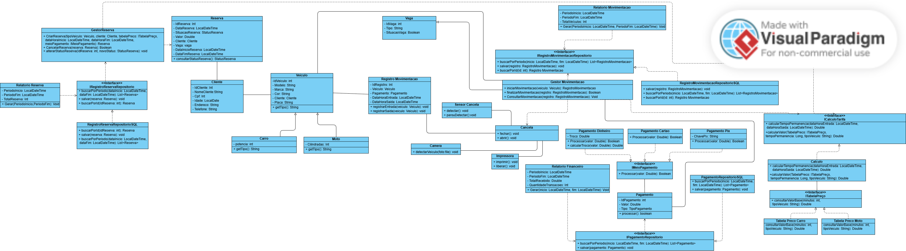

# Sistema de Estacionamento

> Projeto acadêmico da disciplina de **Projeto de Arquitetura de Sistemas** — Ciência da Computação, UNIFOR

## Sobre o Projeto

Este projeto trata da modelagem e implementação de um sistema de controle de estacionamento (vagas, reservas, movimentação de veículos, pagamentos e relatórios), com ênfase na aplicação consciente dos **princípios SOLID** e dos **padrões GRASP** durante o desenho da arquitetura orientada a objetos — da modelagem em UML até a tradução para código Java.

O escopo não foi definido por um enunciado fechado: coube ao grupo escolher o domínio (estacionamento) e delimitar as funcionalidades, priorizando a qualidade das decisões arquiteturais em detrimento de simplesmente ter algo funcionando.

## Diagrama de Classes



## Princípios de Projeto Aplicados

### SOLID

| Princípio | Onde é aplicado |
| --------- | --------------- |
| **SRP** | Cada classe de serviço cuida de uma única responsabilidade: `GestorReserva` trata só de reservas, `GestorMovimentacao` só de entrada/saída de veículos e `Calculo` só do cálculo de permanência e tarifa. |
| **OCP** | A hierarquia `Veiculo` → `Carro`/`Moto`, junto com as interfaces `IMeioPagamento` e `ITabelaPreco`, permite incluir novos tipos de veículo, meio de pagamento ou regra de tarifa criando uma classe nova, sem tocar no que já existe. |
| **LSP** | `PagamentoDinheiro`, `PagamentoCartao` e `PagamentoPix` cumprem o mesmo contrato de `IMeioPagamento` e podem ser trocadas entre si sem que o restante do sistema perceba diferença de comportamento. |
| **ISP** | As interfaces foram mantidas pequenas e focadas (`ICalculoTarifa`, `ITabelaPreco`, `IMeioPagamento` e uma interface por repositório), evitando um contrato único e genérico que forçasse implementações a lidar com métodos que não usam. |
| **DIP** | `GestorReserva` recebe `ITabelaPreco` e `IMeioPagamento`, `Calculo` recebe `ITabelaPreco` e `Pagamento` delega a `IMeioPagamento` — todos dependem das abstrações, e não das implementações concretas. As interfaces de repositório já estão definidas, mas ainda não são injetadas nos serviços (ver [Status de implementação](#status-de-implementação)). |

### GRASP

| Padrão | Onde é aplicado |
| ------ | --------------- |
| **Information Expert** | `RegistroMovimentacao.registrarEntrada()/registrarSaida()` — a própria classe que tem os dados de horário é responsável por atualizá-los. |
| **Creator** | `GestorReserva` é responsável por instanciar `Reserva`; `GestorMovimentacao` é responsável por instanciar `RegistroMovimentacao`. |
| **Controller** | `GestorReserva` e `GestorMovimentacao` concentram a coordenação entre as ações do sistema e as regras de negócio. |
| **Low Coupling / High Cohesion** | Dependência via interface sempre que há variação (pagamento, tarifa, persistência); cada classe mantém foco em uma única responsabilidade. |
| **Polymorphism** | A escolha de qual meio de pagamento ou tabela de preço usar é resolvida por tipo (polimorfismo de interface), sem cadeias de `if/else`. |
| **Pure Fabrication** | `RegistroReservaRepositorioSQL`, `RegistroMovimentacaoRepositorioSQL`, `PagamentoRepositorioSQL` e `Calculo` não correspondem a nenhum conceito do domínio real — foram criadas para manter a arquitetura desacoplada. |
| **Indirection** | `Pagamento` atua como intermediário entre o restante do sistema e as implementações concretas de `IMeioPagamento`. |
| **Protected Variations** | As interfaces `IMeioPagamento` e `ITabelaPreco` blindam o restante do sistema contra mudanças em pagamento e tarifação; as interfaces de repositório fazem o mesmo para a futura persistência. |

## Tecnologias

- **Java 17+**
- **IntelliJ IDEA**

## Estrutura do Projeto

```
src/br/com/estacionamento/
├── Main.java        # demonstração do fluxo principal
├── model/           # Veiculo, Carro, Moto, Cliente, Vaga, Reserva, StatusReserva, Pagamento, TipoPagamento, RegistroMovimentacao
├── interfaces/      # IMeioPagamento, ITabelaPreco, ICalculoTarifa, IPagamentoRepositorio, IRegistroReservaRepositorio, IRegistroMovimentacaoRepositorio
├── service/         # GestorReserva, GestorMovimentacao, Calculo, PagamentoDinheiro/Cartao/Pix, TabelaPrecoCarro/Moto, Camera, Cancela, SensorCancela, Impressora
│   └── relatorio/   # RelatorioReserva, RelatorioMovimentacao, RelatorioFinanceiro
└── repository/      # PagamentoRepositorioSQL, RegistroReservaRepositorioSQL, RegistroMovimentacaoRepositorioSQL
```

## Funcionalidades

| Funcionalidade | Status |
| -------------- | ------ |
| Modelagem de clientes | Entidade `Cliente` pronta; sem serviço de cadastro |
| Reserva de vagas | `GestorReserva` cria e cancela reservas; falta associar vaga, calcular valor e cobrar |
| Registro de entrada e saída de veículos | `GestorMovimentacao` registra entrada e saída (em memória, sem persistência) |
| Cálculo de tarifa conforme tipo de veículo e tempo de permanência | `Calculo` e `TabelaPrecoCarro`/`TabelaPrecoMoto` implementados (tarifa por minuto) |
| Pagamento via dinheiro, cartão ou pix | Estrutura pronta; `processar()` ainda é simulado (retorna `true`) |
| Simulação dos componentes físicos (sensor, câmera, cancela, impressora) | Classes criadas; lógica pendente (`TODO`) |
| Emissão de relatórios administrativos (financeiro, movimentação e reservas) | Classes criadas; consulta aos repositórios pendente (`TODO`) |

## Status de implementação

Projeto em fase de **modelagem e arquitetura**:

- Os repositórios `*RepositorioSQL` são stubs: não há conexão com banco de dados e nenhum serviço os utiliza ainda.
- Câmera, cancela, sensor, impressora e relatórios têm a estrutura criada, mas a lógica está pendente (`TODO`).
- A classe `Main` executa uma demonstração com o que já está implementado: entrada e saída de um carro e de uma moto, cálculo de tarifa, pagamento e criação/cancelamento de reserva.

## Como Executar

**Pré-requisito:** JDK 17 ou superior instalado.

### Pela IntelliJ IDEA (recomendado)

1. Abra a pasta do projeto (`File → Open`).
2. Confirme que a pasta `src` aparece em azul na árvore de arquivos (indica que está marcada como *Sources Root*).
3. Abra `src/br/com/estacionamento/Main.java` e clique com o botão direito sobre ela.
4. Selecione **Run 'Main.main()'**.
5. A saída aparece no painel *Run*, na parte inferior da IDE.

### Pelo terminal

```
# a partir da pasta src, compila todos os .java para a pasta out/ (na raiz do projeto)
javac -encoding UTF-8 -d ../out $(find br -name "*.java")

# executa a classe Main
java -cp ../out br.com.estacionamento.Main
```

No Windows (PowerShell), a compilação fica:

```
javac -encoding UTF-8 -d ../out (Get-ChildItem -Recurse -Filter *.java br).FullName
```

Se os acentos aparecerem trocados no terminal do Windows, rode `chcp 65001` antes de executar.

### Saída esperada

```
=== SISTEMA DE ESTACIONAMENTO ===

--- Carro: Chevrolet Onix ---
Entrada e saída registradas
Permanência:        90 min
Valor a pagar:      R$ 18,00
Pagamento (PIX): aprovado

--- Moto: Honda CG 160 ---
Entrada e saída registradas
Permanência:        45 min
Valor a pagar:      R$ 5,40
Pagamento (CARTAO): aprovado

--- Reserva ---
Reserva criada para Cliente de Demonstração (duração: 3 horas)
Status: PENDENTE
Status após cancelamento: CANCELADA
```

A saída é sempre a mesma: a permanência é simulada (90 e 45 minutos) e não depende do relógio.

## Autores

- **Samuel Batista Oliveira**
- **Pedro Lucas de Oliveira Duarte**
- **José Valter Alves de Lima Junior**

Disciplina: Projeto de Arquitetura de Sistemas — Prof. Ronaldo Pinheiro